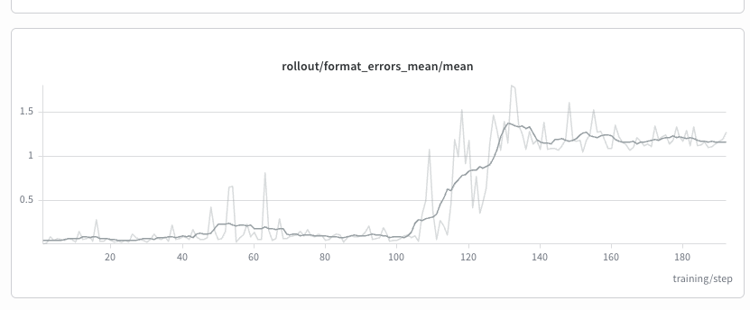
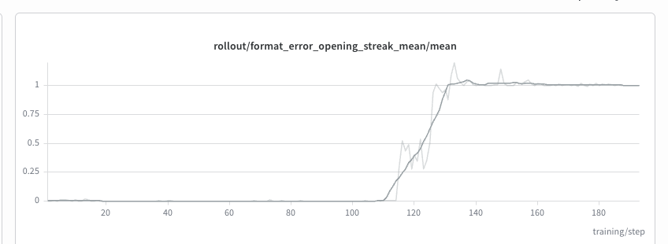

# Bag of Tricks in Open Source RL Infra

*By Yichuan Wang*

*To be finished.*

I'll use this post to collect a growing bag of tricks in open-source RL infrastructure: practical notes and lessons learned along the way.

## 1. Rollout Concurrency and Load Balancing Across DP Ranks

The first trick is choosing the maximum rollout concurrency: how many rollouts should be in flight to keep GPUs busy and the workload balanced across data-parallel (DP) serving ranks?

### Start with the concurrency limits

For a pipeline where `max_async_steps` bounds the number of in-flight rollout batches, `batch_size` is the number of prompts per batch, and `group_size` is the number of rollouts per prompt, the hard upper bound is:

```text
pipeline_concurrency_cap = max_async_steps * batch_size * group_size
```

But that does not mean the serving engines can efficiently handle that many concurrent requests. KV-cache capacity gives us another constraint. For now, leave KV-cache offloading out of the picture; with offloading, a similar capacity calculation would also need to account for data movement.

We can roughly estimate how many requests each DP rank can accommodate as:

```text
x ≈ usable_KV_pool_bytes / (avg_agent_trace_tokens * KV_bytes_per_token)
```

Here, the KV pool and per-token footprint should be measured on the same basis for one serving replica, accounting for any tensor parallelism within it. The trace length approximates the tokens whose KV cache a request needs to retain.

For equally sized DP replicas, a starting point is therefore:

```text
max_rollout_concurrency ≈ min(pipeline_concurrency_cap, x * DP)
```

**My practical rule of thumb:** once rollout concurrency is controlled this way, you generally do not need to impose an additional, tighter engine-side concurrency cap just to optimize per-request latency. RL is a throughput-oriented job :). Keep vLLM's `max_num_seqs` and SGLang's `max_running_requests` large enough—or even leave them unset if the defaults already accommodate the intended per-rank concurrency—within the engine's memory and execution limits. These knobs also constrain scheduling and resource usage, so they are not exclusively latency controls; the point is to avoid an unnecessarily low limit becoming a second bottleneck. See the [vLLM engine arguments](https://docs.vllm.ai/en/latest/cli/run-batch/) and [SGLang server arguments](https://docs.sglang.ai/advanced_features/server_arguments.html) for their definitions.

The idea is to admit only as much work as the engines can keep resident, reducing waiting queues and KV-cache pressure that could trigger preemption and recomputation. A waiting queue by itself does not imply thrashing; the problem is overcommitting the resident working set. In practice, this estimate also needs headroom.

### Why the estimate is still rough

There are several things this calculation leaves out:

- **Trace lengths change during training.** If agents generate longer trajectories as training progresses, the concurrency target needs to change with them.
- **Average full-trace length is not current occupancy.** Some running requests have just started, while others are close to finishing. Their live KV footprints differ. Agent rollouts can also spend time waiting for tools or environments, so rollout concurrency is not the same as active inference concurrency.
- **An average hides bursts and outliers.** Unexpectedly long requests can exhaust the available headroom, while a wave of short requests can leave capacity unused.

So squeezing compute out of an RL pipeline is not trivial. The capacity estimate is a starting heuristic, not a guarantee of either full GPU utilization or perfect load balance.

Compared with general coding-agent serving, though, RL seems to offer additional opportunities for systems optimization. Rollouts come in groups associated with the same prompt, giving the scheduler more information about the workload. Whether those group relationships can help predict resource demand or improve scheduling is worth exploring further.

#### Advanced trick: adapt concurrency to live agent trace lengths

A more advanced trick would be to dynamically adjust `max_rollout_concurrency` based on the trace lengths of currently running agents. As the live traces grow and KV-cache headroom shrinks, admit fewer new rollouts; when capacity becomes available, increase concurrency again, subject to the pipeline cap.

The challenge is that a running trace's current length does not tell us how much longer it will grow. A useful controller would need to account for that uncertainty and avoid reacting too aggressively to temporary changes. This is a direction I would like to explore further: moving from a fixed average-length estimate to a concurrency limit that adapts to the workload during training.

### Sticky sessions, least-loaded placement

A simple, practical routing baseline is **sticky sessions with least-loaded placement for new sessions**: choose a DP rank when a rollout starts, then keep subsequent requests from that rollout on the same rank to preserve cache locality.

The interesting question is how to define "least loaded":

- **Request count:** route to the engine with the fewest outstanding requests. This is simple, but treats short and long requests equally.
- **Active KV-cache usage:** route to the engine with the smallest live KV footprint.
- **Available KV capacity:** route to the engine with the most usable space, accounting for free blocks and cached blocks that can be evicted.

An eviction-based metric needs a precise denominator: `1 - evictable_ratio` is not automatically the same as active KV utilization, especially when free blocks are counted separately.

Sticky sessions trade some freedom to rebalance ongoing work for cache locality, so this policy does not guarantee perfect balance. Still, it looks like a useful baseline. Which load metric performs best—and how it should interact with the concurrency limit—needs further measurement.

## 2. Beating Format Errors: End the Episode on the First Error

The second trick is about format errors in multi-turn agent RL. I'll use [Terminus 2](https://www.tbench.ai/) as the running example: each turn, the model must reply in a fixed XML format (a `<response>` block containing `<commands>`), and a parser turns that reply into terminal actions.

### The problem: rescued format errors get rewarded

During training, I kept seeing episodes where a turn had a format error, yet the episode still ended with the correct reward. When the parser rejects a turn, that turn is wasted, but the agent can spend a few more turns making up for it. The final reward only checks the outcome, so the broken turn gets credited along with everything else.

This rewards the wrong behavior. Consider a GRPO group of 12 rollouts for a hard task where only one succeeds, and that one is missing the opening `<response>` tag but recovers. Its advantage is strongly positive, so RL pushes up every token in that trajectory, including the malformed turn. The model learns that skipping `<response>` is fine, or even good. After training, the error becomes more common: the model stops emitting the opening `<response>` on future turns, and the problem compounds.

Here is what this looked like in one of my lenient training runs:





- **For the first ~100 steps, format errors are rare.** The mean number of format errors per rollout stays around 0.05–0.1, apart from a small bump around steps 45–65 that goes away on its own.
- **Then it flips within ~30 steps.** Between steps ~105 and ~130, the mean jumps to about 1.3–1.4, then settles around 1.2 for the rest of training. It never comes back down.
- **The opening streak shows what the model learned.** `format_error_opening_streak` counts consecutive format errors at the start of an episode. It is exactly 0 until step ~110, climbs to 1.0 by step ~132, and then stays flat at 1.0 with almost no variance. Essentially every rollout now opens with exactly one broken turn, then recovers and continues normally.
- **Most of the format errors are that first turn.** With the opening streak at 1.0 and total format errors around 1.2, the "break the first turn, then recover" pattern accounts for nearly all of them.

The model did not drift into random noise. It converged on a stable, deterministic habit: waste the first turn, then do the task. Under lenient handling, this habit costs nothing whenever the recovery succeeds, so RL locks it in.

### The fix: end the episode immediately, with zero reward

The solution is blunt: as soon as a format error happens, end the episode and give it zero reward. A rescued trajectory should never receive a positive advantage. I control this with two switches, both **on by default for training**:

- **`SWE_STRICT_FORMAT=1`**: if the parser rejects any turn (missing opening `<response>`, plain text with no XML, or missing `<commands>`), the episode ends immediately. It is not graded, and the reward is 0.
- **`SWE_STRICT_TRUNCATION=1`**: if a single turn fills the full 16,384-token limit, the episode also ends immediately with reward 0. Terminus does not get to salvage the truncated output, and the model is not asked to rewrite it.

A few details matter:

- **Empty commands and silent no-ops only produce warnings.** They do not end the episode. They are wasteful, but they are not broken output.
- **Hitting the context limit for the whole conversation is unchanged.** That was already handled as no submission and a score of 0.
- **Eval stays lenient by default** (`SWE_EVAL_STRICT_FORMAT=0`, `SWE_EVAL_STRICT_TRUNCATION=0`), so TB2.1 scores remain comparable to public results. To make eval strict as well, turn both switches on.

The takeaway: in outcome-reward RL, any bad behavior that can be "rescued" later in a trajectory will be reinforced whenever the rescue succeeds. If you do not want the model to learn a behavior, make sure that behavior can never appear in a positively rewarded trajectory.

<!-- TODO(figure 2): training reward / TB2.1 eval score over steps, lenient vs strict. -->
